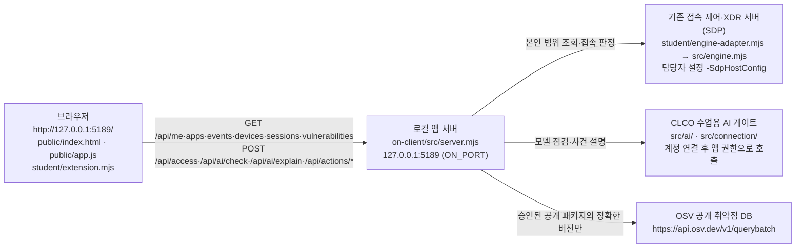

# 다아트 학생 실행 설명서와 시스템 구성도

이 문서는 학생 「다아트」가 13~21단계에서 작성한 학생 문서입니다. 제공 문서(`README.md`, `docs/STUDENT_LAUNCH_GUIDE.md`, `docs/CONNECTION_TROUBLESHOOT.md` 등)는 고치지 않았으며, 이 문서는 그 내용을 이 프로젝트에서 실제로 확인한 결과와 함께 정리합니다.

표기 규칙:

- **확인함**: 이 PC의 실제 화면이나 PowerShell에서 직접 확인한 것
- **코드 확인**: 저장소의 코드·설정 파일을 읽어서 확인한 것(실행하지 않음)
- **모의 점검**: 학생 함수에 모의 입력을 넣어 Node로 점검한 것(실제 연결 아님)
- **기다림(UNV)**: 아직 확인하지 못한 것. 성공이나 정상으로 보지 않습니다.

## 1. 목적과 기능

다아트는 회사 직원이 자기 로그인 상태, 업무 앱 접속 판정, 최근 접속·XDR 기록, AI 사건 설명, 조치 상태, 설치 패키지의 알려진 취약점 조회 결과를 확인하는 보안 Agent 앱입니다. 화면은 **제공 UI**와 **학생 구현 표시**(`student/extension.mjs`)로 나뉩니다. 학생 칸은 제공 코드가 검증한 값을 읽어 보여 주기만 하며, 요청을 보내거나 조치를 실행하지 않습니다.

## 2. 지원 환경과 버전

| 항목 | 값 | 근거 |
|---|---|---|
| 운영체제 | Windows, PowerShell | 확인함(이 PC에서 실행) |
| Node.js | 22~24 지원, 수업 기준 24.19.0. 외부 npm 의존성 없음 | 코드 확인(`package.json`의 `engines.node`, `tools/start-alekov.ps1`의 버전 검사) |
| 이 PC의 Node.js 실제 버전 | v24.21.0 (지원 범위 22~24 안, 수업 기준 24.19.0과 다름) | 확인함(2026-10-26, 실행 도구의 「참고: 지금 Node.js 는 v24.21.0 입니다.」 문구) |
| 시작 틀 | `alekov-client-starter` 0.2.20 | 코드 확인(`package.json`) |
| 브라우저 | PC 브라우저(Chrome에서 화면 확인) | 확인함 |
| package-lock.json | 이 앱 폴더에는 없음(외부 의존성 없음) | 코드 확인 |

## 3. 폴더 구조

```text
D:\claude code\Daat-blockage\          ← 프로젝트 폴더 = Git 최상위(커밋·제출 기준)
└─ on-client\                          ← 앱 폴더(여기서 PowerShell을 열고 실행)
   ├─ package.json                     ← 실행 스크립트(start·demo·check)
   ├─ .env.example                     ← 비밀 없는 설정 견본(ON_PORT=5189 등)
   ├─ tools\start-alekov.ps1           ← 제공 실행 도구
   ├─ src\server.mjs                   ← 제공 로컬 앱 서버(127.0.0.1:5189)
   ├─ src\engine.mjs, src\engine\      ← 기존 접속·XDR 서버(SDP) 연결부
   ├─ src\ai\, src\connection\         ← 계정 연결·AI 게이트 연결부
   ├─ src\vulnerabilities\             ← package-lock 대조·OSV 조회
   ├─ src\actions\                     ← 조치 준비·집행·결과 조회
   ├─ public\index.html, public\app.js ← 제공 화면
   ├─ student\extension.mjs            ← 학생 작성 화면 함수(13~20단계)
   ├─ student\engine-adapter.mjs       ← 제공 연결 어댑터(기본: 연결 없음)
   └─ docs\STUDENT_RUNBOOK.md          ← 이 문서(학생 작성)
```

Git 저장소의 최상위는 `on-client`가 아니라 그 위의 `Daat-blockage` 폴더입니다. 커밋 경로는 `on-client/student/extension.mjs`처럼 표시됩니다(확인함: 18~20단계 커밋 출력).

## 4. 실행 절차

### 4.1 PowerShell 여는 위치

1. 파일 탐색기에서 `D:\claude code\Daat-blockage\on-client` 를 엽니다.
2. 주소 표시줄에 `powershell` 을 입력하고 Enter를 누릅니다. 그 폴더에서 새 PowerShell 창이 열립니다.

### 4.2 실행 전 확인(선택)

```powershell
node -v
node --check .\student\extension.mjs
```

- `node -v` 는 22~24 버전이어야 합니다. `node` 와 `-v` 사이만 띄우고 `-v` 는 붙여 씁니다. `node - v` 처럼 띄우면 Node 대화형 창(`>`)이 열리며, 이때는 `Ctrl+C` 를 두 번 눌러 빠져나옵니다(확인함).
- `node --check` 는 오류가 없으면 아무것도 출력하지 않습니다(확인함: 18~20단계 커밋 전 통과).
- 이 PC는 PowerShell 실행 정책 때문에 `npm` 대신 `npm.cmd` 를 써야 할 수 있습니다. 예: `npm.cmd run check`. `npm.cmd` 실행 결과는 기다림(UNV)입니다.

### 4.3 앱 켜기

```powershell
powershell -NoProfile -ExecutionPolicy Bypass -File .\tools\start-alekov.ps1
```

실행 도구는 먼저 계정 연결 설정을 준비하고 「계정 연결 준비가 끝났습니다. 앱에서 확인 번호로 로그인·승인을 진행하세요.」를 출력합니다(확인함). 이 문구는 설정 준비만 뜻하며 로그인·AI 연결 완료가 아닙니다.

정상 시작 신호(확인함: 2026-10-26 새 PowerShell 창에서 이 순서대로 출력됨):

```text
계정 연결 준비가 끝났습니다. 앱에서 확인 번호로 로그인·승인을 진행하세요.
참고: 지금 Node.js 는 v24.21.0 입니다. 수업 기준은 v24.19.0 입니다.
케셰브 연결 확인: http://127.0.0.1:5189
케셰브가 켜졌습니다. 브라우저에서 http://127.0.0.1:5189/ 을 여세요.
서버가 응답한 것만 확인했습니다. AI 연결 상태는 화면에서 따로 확인해 주세요.
끄려면 이 창에서 Ctrl+C 를 누르세요.
```

- 앱 이름은 제공 실행 도구에 「케셰브」로 들어 있습니다. 화면 제목은 학생 꾸밈 설정에 따라 다를 수 있습니다.
- Node.js가 v24.19.0이 아니면 「참고: 지금 Node.js 는 vXX 입니다. 수업 기준은 v24.19.0 입니다.」가 함께 나옵니다(코드 확인).
- `-ExecutionPolicy Bypass` 는 이 한 번의 실행에만 적용되고 PC 설정을 바꾸지 않습니다.

### 4.4 브라우저 주소

`http://127.0.0.1:5189/` 를 엽니다. 서버는 `127.0.0.1` 에서만 듣습니다(코드 확인: `src/server.mjs`의 `server.listen(port,'127.0.0.1')`). 포트를 바꿨다면 주소도 같은 번호로 엽니다.

확인함: 이 PC에서 `http://127.0.0.1:5189` 가 열리고, 「보호 현황」「보안 기록」 탭과 학생 카드가 표시됐습니다. 이 실행은 기존 서버·에이전트가 연결되지 않은 상태였습니다(화면 문구 「연결 없음: 실제 회사 시스템에 연결되어 있지 않습니다.」).

### 4.5 종료와 다시 실행

| 할 일 | 방법 |
|---|---|
| 종료 | 실행한 PowerShell 창에서 `Ctrl+C`. 브라우저 주소가 더 이상 열리지 않으면 종료된 것입니다. |
| 다시 실행 | 같은 `on-client` 폴더에서 4.3의 명령을 다시 실행합니다. 실행·종료는 학생 파일을 바꾸지 않습니다. |
| 학생 코드 수정 뒤 반영 | 브라우저를 새로고침합니다. 화면에 반영되지 않으면 종료 뒤 다시 실행합니다. |
| 포트 충돌 | 명령 끝에 ` -Port 5190` 을 붙이고 `http://127.0.0.1:5190/` 을 엽니다. |
| 예제 자료로 보기 | ` -Demo` 를 붙입니다. 예제 자료이며 실제 연결이나 성취가 아닙니다. |

`-Background`, `-NoNativeHost`, `-SdpHostConfig`, `-NativeHostConfig`, `-WaitSeconds` 옵션은 실행 도구에 있지만(코드 확인) 이 PC에서 써 보지 않았습니다(기다림(UNV)). SDP·계정 연결 설정 파일은 담당자가 안내할 때만 쓰며 프로젝트·Git 밖에 둡니다.

## 5. 시스템 구성도



같은 내용을 표로 적습니다.

| 상자 | 실제 파일·주소 | 역할 | 이 PC에서 확인한 상태 |
|---|---|---|---|
| 브라우저 | `http://127.0.0.1:5189/`, `public/index.html`, `public/app.js`, `student/extension.mjs`(브라우저가 `/student/extension.mjs` 로 불러옴) | 제공 화면이 서버에 요청하고 검증한 값을 학생 함수에 넘김 | 확인함: 화면 표시 |
| 로컬 앱 서버 | `src/server.mjs`, `127.0.0.1:5189` | `/api/*` 경로 처리, 외부 연결 중계, 오류 코드 정리 | 확인함: 응답함 |
| 기존 접속 제어·XDR 서버 | `student/engine-adapter.mjs`(기본 `evidenceMode: 'disconnected'`), `src/engine.mjs`, `src/engine/sdp-host.mjs` | 사용자·기기·세션·업무 앱 판정·보안 기록 | 연결 안 됨: `ENGINE_NOT_CONNECTED` |
| CLCO 수업용 AI 게이트 | `src/ai/service.mjs`, `src/connection/manager.mjs`. 주소·열쇠는 신뢰된 연결 설정이 보관하며 이 문서와 저장소에 적지 않음 | AI 연결 점검, 사건 설명 | 「AI 연결 점검 전」. 실제 점검·설명은 기다림(UNV) |
| OSV | `https://api.osv.dev/v1/querybatch`, `src/vulnerabilities/osv.mjs`, `src/vulnerabilities/project-scan.mjs` | package-lock과 node_modules의 정확한 버전을 알려진 취약점과 대조 | 조회 대상 미설정: `not_configured`(`PROJECT_NOT_CONFIGURED`) |

ASCII 요약:

```text
[브라우저 127.0.0.1:5189] --/api/*--> [src/server.mjs]
                                        ├─> [SDP 접속·XDR]  (engine-adapter.mjs, 지금은 연결 없음)
                                        ├─> [CLCO AI 게이트] (src/ai, 계정 연결 필요)
                                        └─> [OSV api.osv.dev] (승인 목록이 비면 조회 안 함)
```

설정 견본(`.env.example`, 비밀 없음): `ON_PORT=5189`, `ON_ENGINE_ADAPTER=./student/engine-adapter.mjs`, `ON_AI_MODEL=aleph/auto`, `ON_PROJECT_DIRECTORY=`(비어 있음), `ON_APPROVED_PUBLIC_PACKAGES=[]`. 키·토큰·비밀번호는 이 문서와 저장소에 넣지 않습니다.

## 6. 제공 코드와 학생 작성 부분

제공/학생 구분 기준은 `.on-starter-manifest.json`(제공 파일 목록과 해시)과 각 카드의 표시(「제공」 / 「student/extension.mjs · 함수명」)입니다.

| 구분 | 파일 | 내용 |
|---|---|---|
| 제공 | `src/**`, `public/**`, `tools/**`, `student/engine-adapter.mjs`, 제공 `docs/**`, `README.md`, `package.json`, `.env.example` | 서버, 요청·검증, 버튼, 늦은 응답 차단, 조치 확인 티켓 보관 |
| 학생 | `student/extension.mjs`, `docs/STUDENT_RUNBOOK.md` | 검증된 값을 받아 상태를 글자로 구분해 보여 주는 화면 함수, 이 문서 |

학생 함수(모두 `createElement`·`textContent`만 사용, 학생 칸에 실행 버튼 없음):

| 단계 | 함수 | 보여 주는 것 | 확인 수준 |
|---|---|---|---|
| 13 | `renderIdentity` | 로그인 사용자·현재 기기·현재 세션, 불러오는 중·실패·확인 불가 구분 | 실제 화면: 연결 없음 상태만 |
| 14 | `renderDecision` | 업무 앱 접속 판정(허용·차단·추가 확인·판정 불명)과 모드 안내 | 코드 확인 |
| 15 | `renderEvents` | 접속·XDR 기록 목록, 종류·앱·접속 상태 필터(label 연결), 상세 근거·규칙 | 실제 화면: 기록 불러오기 실패 표시 |
| 16 | `renderStatus` | 등록 기기·현재 세션·알림·도움정보 복사(직접 누를 때만) | 확인함: 알림 5건 `ENGINE_NOT_CONNECTED` 표시 |
| 17 | `renderAiConnection` | AI 연결 점검 결과와 오류 원인별 안내 | 확인함: 「AI 연결 점검 전」 |
| 18 | `renderExplanation` | 선택한 사건 ID·AI 요약(참고용)·근거 ID와 근거 글·규칙·확인 불가 상태·제안 미실행, 근거 불일치 거부 | 확인함: 「보안 기록에서 기록을 먼저 고르세요」. 나머지는 모의 점검 |
| 19 | `renderAction` | 조치 상태(idle~error)별 문장, `effectApplied: true` 관측일 때만 효과 확인, 식별자 표시 | 확인함: 「아직 미실행(idle)」. 나머지는 모의 점검 |
| 20 | `renderVulnerabilities` | 조회 전·중·실패, 전체 상태 5가지, lock 정보, 패키지 행의 정확한 버전·취약점 ID·수정 시각 | 확인함: `not_configured` 가 제공 카드와 같은 값. 나머지는 모의 점검 |

## 7. 장애별 확인 순서

화면이나 PowerShell에 실제로 나오는 문구 기준입니다. 문구는 제공 코드에서 확인했고, ✔ 표시는 이 PC 화면에서 실제로 본 것입니다.

| 보이는 문구 | 원인 | 확인 순서 | 복구 |
|---|---|---|---|
| `Node.js 가 없습니다` / `지금 Node.js 는 vXX 입니다` | Node 없음·지원 범위 밖 | 1) `node -v` 2) 22~24인지 | Node.js 24.19.0 설치 후 새 PowerShell 창에서 다시 실행 |
| ✔ `포트 5189 를 다른 프로그램이 쓰고 있습니다` | 포트 충돌. 이 PC에서는 이미 켜 둔 다아트 앱 창이 5189를 쓰고 있었음 | 1) 앞서 실행한 앱 PowerShell 창이 남아 있는지 2) 다른 프로그램인지 | 이전 앱이면 그 창에서 `Ctrl+C` 후 다시 실행. 다른 프로그램이면 그대로 두고 ` -Port 5190` 으로 실행, 주소도 `:5190` |
| `앱 서버가 20 초 안에 뜨지 않았습니다` | 서버 응답 지연 | 창 메시지 전체 확인 | 메시지와 도움정보를 강사에게 전달 |
| ✔ `기존 서버·에이전트의 연결을 확인할 수 없습니다. 연결 어댑터를 먼저 확인하세요.` (`ENGINE_NOT_CONNECTED`) | 이 실행에 SDP 연결이 없음(기본 어댑터 `disconnected`) | 1) 화면 위 「연결 없음」 안내 2) 담당자가 SDP 설정을 안내했는지 | 담당자 안내가 있을 때만 `-SdpHostConfig` 로 실행. 설정·키를 직접 만들지 않음 |
| ✔ `연결 없음: 실제 회사 시스템에 연결되어 있지 않습니다.` | 위와 같음 | 정상 연결 성공이 아님 | 위와 같음 |
| ✔ `AI 연결 점검 전` | 점검을 누르지 않음 | 「AI 연결」 카드의 계정 연결·승인 순서 | 「현재 API 연결 점검」을 직접 누름(유료 요청 여부를 먼저 확인) |
| `AI 연결 점검 실패: 권한 준비 중·확인 불가(ON_AI_PROVISIONING_PENDING)` | 앱 권한 준비 전 | 계정 연결·앱 승인을 마쳤는지 | 담당자에게 앱 권한 확인 요청 |
| `AI 설명 실패: …(ON_AI_INVALID_OUTPUT)` + 근거 불일치 | AI 응답의 근거 ID·조치·형식이 기록과 다름 | 기록은 그대로인지 | 직접 다시 요청. 근거를 고쳐 맞추지 않음 |
| `결과 불명(unknown): 효과 없음으로도 성공으로도 판단하지 마세요.` | 조치 결과를 확인할 수 없음 | 같은 조치를 다시 집행하지 않음 | 「원천 결과만 재조회」를 직접 누름 |
| ✔ `조회 준비 미완료(not_configured)` (`PROJECT_NOT_CONFIGURED`) | 조회 대상 프로젝트 설정 없음(`ON_PROJECT_DIRECTORY` 비어 있음) | 취약점 없음이 아님 | 담당자가 대상 경로를 준비. 학생이 임의로 설정하지 않음 |
| `아직 조회 안 함(not_checked)` (`NO_APPROVED_PACKAGES`) | 승인된 공개 조회 대상 없음(`ON_APPROVED_PUBLIC_PACKAGES=[]`) | 취약점 없음이 아님 | 담당자가 허용 목록 준비 |
| `조회 실패: …` / `조회 취소: …` | 시간 초과·응답 형식 불일치·취소 | 이전 결과를 현재 결과로 보지 않음 | 「설치 패키지 조회」를 직접 다시 누름 |

계정 연결·AI 승인·OSV의 전체 오류 코드는 제공 문서 `docs/CONNECTION_TROUBLESHOOT.md` 를 봅니다.

## 8. 지원 범위: 확인한 것과 기다림(UNV)

확인함(이 PC 실제 화면·PowerShell):

- `http://127.0.0.1:5189` 에서 앱 화면이 열림(연결 없음 모드)
- 알림 5건이 `ENGINE_NOT_CONNECTED` 로 표시됨, 기록 목록 불러오기 실패 표시
- 18단계 기록 없음 안내, 19단계 idle 안내와 학생 칸 버튼 없음, 20단계 `not_configured` 가 제공 카드와 같은 코드·시각
- `node --check student/extension.mjs` 통과(18·19·20단계 커밋 전)
- Node.js v24.21.0, 실행 도구의 계정 연결 준비 문구와 포트 사용 중 안내(이미 켜 둔 앱 때문)
- 새 PowerShell 창에서 4.1~4.3 절차대로 실행해 「케셰브가 켜졌습니다」와 「끄려면 이 창에서 Ctrl+C 를 누르세요.」까지 출력됨. `케셰브 연결 확인` 줄은 기본 실행(SDP 미연결)에서도 나오는 서버 시작 줄이며 실제 연결 성공이 아님

- 이 문서에 적은 버튼 이름(「설치 패키지 조회」「패키지 조회 취소」「현재 API 연결 점검」「대상과 조치를 확인했으며 집행합니다」「원천 결과만 재조회」「조치 화면 취소」「AI 설명 취소」)이 화면과 같음(2026-10-26 사용자 대조, 누르지 않음)

모의 점검(실제 연결 아님): 18단계 21개, 19단계 20개, 20단계 17개 항목 통과.

기다림(UNV):

- SDP(기존 접속 제어·XDR) 연결, 실제 사용자·기기·세션·업무 앱 판정·보안 기록
- 계정 연결, AI 앱 승인, 실제 AI 연결 점검과 사건 설명 성공
- 실제 조치 준비·집행·결과 재조회(연동 시스템 미준비, 시험 집행 안 함)
- 실제 OSV 조회 결과와 package-lock.json 버전 대조(조회 대상 미설정)
- `npm.cmd start`, `npm.cmd run demo`, `-Background` 등 다른 실행 방법
- 공식 단계 판정 결과

OSV는 알려진 취약점 데이터베이스입니다. 조회 결과가 없다는 사실만으로 패키지나 앱 전체가 안전하다고 보장하지 않습니다. AI 설명은 참고 정보이며, 설명·제안만으로 보안 조치가 실행되지 않습니다.
